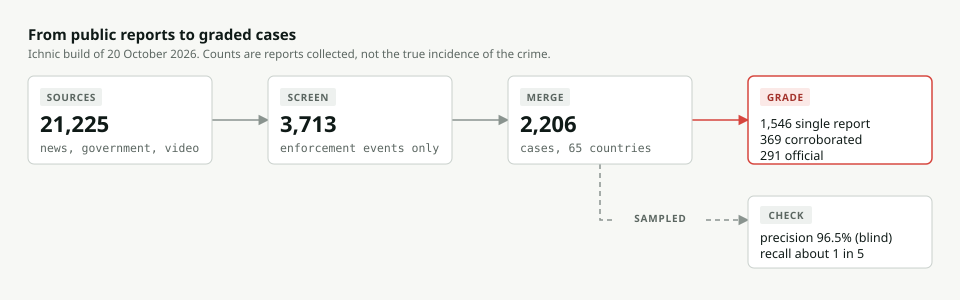

# Reading the evidence on illegal wildlife trade: a lesson built on Ichnic

This file is the source for an interactive lesson. Load it into OpenMAIC (github.com/THU-MAIC/OpenMAIC,
"create a classroom from a document"), or teach from it directly. Every figure comes from the live Ichnic
build of 20 October 2026; the numbers on the site update daily, so check them before teaching.

**Who it is for:** journalists, students of conservation or criminology, and policy staff who meet wildlife
trade numbers and need to judge them. No coding is needed; one activity uses a spreadsheet.

**Length:** about 60 minutes, in six scenes, a quiz and a project.

## What learners should be able to do afterwards

1. Say what a "case" in Ichnic is, and why a count of cases is a count of reports, not of crimes.
2. Read an evidence grade (single report, corroborated, official) and say what each one can carry.
3. Explain precision and recall in plain words, and why a 96.5% figure says nothing about missed events.
4. Use two government trade records (CITES seizures, US port seizures) to check a news-based claim.
5. Name one thing each dataset cannot tell you before quoting it.

## Scene 1. The question comes first (8 minutes)

Ichnic opens with questions: "Which wildlife is seized most often?", "Is wildlife sold
online ever caught?", "How often does a seizure end in a conviction?". Each answer gives one number, its
sources, and a paragraph headed "What you should know" that states the limit of that number.

Teaching point: ask learners to pick a question and read its limit aloud before they read its number.

## Scene 2. Where the cases come from (10 minutes)

The build of 20 October 2026 read 21,225 public records: news found through Google News and GDELT, official
government and court pages, Hong Kong Government press releases, and enforcement videos. A screen keeps only
reports of an enforcement event (a seizure, arrest, prosecution, conviction, or a rescue linked to trade):
3,713 candidates. Reports of the same event are merged into one case: 2,206 cases in 65 countries,
January 2024 to October 2026. Nobody accused is ever named.

Teaching point: each step throws information away on purpose. Ask learners what a feature story about
pangolins, a government statistics release and a documentary on YouTube have in common (none of them is a
case) and why.

## Scene 3. How strong is each case? (10 minutes)

Every case carries a grade: single report (one outlet, 1,546 cases), corroborated (two or more independent
outlets, 369) or official (a government, customs, police or court source, 291). A single report is a lead to
check. Videos are only used to corroborate a news case: in two blind audits only 82% of video-only cases were
real events, against 96.5% for the published cases.

Teaching point: a grade describes the evidence behind a case. An official case can still name the wrong
species, and a single report can be right in every detail.

## Scene 4. Measured, not asserted: precision and recall (12 minutes)

**Precision** asks: of the cases published, how many are real? A reviewer read 200 randomly drawn cases blind to
the pipeline's score: 193 were genuine enforcement events (96.5%; 95% interval 93.0% to 98.3%).

**Recall** asks: of the real events, how many did Ichnic find? Against an independent list (the Illegal
Wildlife Trafficking Global Observatory, 576 hand-checked events in Ichnic's dates and species), the
matching rule finds 31.2%. A placebo test, moving every reference date by two to three months, shows that 9% to
14% of events "match" by coincidence, so the honest figure is about one in five (20% to 25%).

Teaching point: a high precision and a low recall can both be true of one dataset. Ask
learners which of the two numbers a headline like "Ichnic records 2,206 cases" depends on.

## Scene 5. Checking news against trade records (10 minutes)

Two government sources do not depend on what newsrooms choose to cover:

- **CITES seizure records** (UNEP-WCMC): 24,786 seized shipments reported since 2015. Plants are 15% of them
  but only 11% of news cases, so news under-reports timber, orchids and medicinal plants. Leaving the United
  States aside, the busiest seized route is India to China (333 shipments); US-bound routes are 83% of all
  records, because the United States reports far more completely than other countries.
- **US port seizures** (LEMIS, from the US Fish and Wildlife Service, open releases by Marshall et al. 2025 and
  Eskew et al. 2020): 19,346 seized import records for the groups Ichnic follows.

Teaching point: US records dominate CITES because the United States reports its seizures far more completely
than other countries do.

## Scene 6. What the numbers cannot tell you (10 minutes)

- Counts show where wildlife crime is **reported**, not where it happens or how much of it there is.
- 1,041 of the 2,206 cases name no place; they are counted but not mapped.
- For every conviction in the record there are about 11 seizures (1,318 seizures, 585 arrest reports, 125
  convictions); convictions are reported less than seizures, so this is not a conviction rate.
- Online sales: ECO-SOLVE recorded 30,934 adverts from April 2024 to September 2026; bears in Thailand drew
  1,303 adverts and no Ichnic case in the same period, so the lack of a case says nothing about whether the
  crime happened.

## Quiz (answer key at the end)

1. Ichnic records 79 tiger cases in a country. Which sentence is correct?
   a) There were 79 tiger trafficking crimes there. b) 79 tiger enforcement events were reported in the sources
   Ichnic reads. c) Tiger trafficking rose in that country.
2. A case is graded "single report". What should a journalist do before quoting it?
3. Precision is 96.5%. Does that mean Ichnic finds 96.5% of seizures? Why not?
4. Why does the United States dominate the CITES seizure records?
5. Recall is 31.2% under the matching rule but about 20% to 25% after the placebo test. What does the placebo
   test remove?
6. Plants are 15% of CITES seizures but 11% of news cases. Give one reason.

## Project: check one claim (homework, 45 minutes)

Download `cases.csv` (CC BY 4.0) from tarunv13.github.io/wildtrace/data/cases.csv. Pick one species group and
one country. Count the cases by grade and by year. Then open the group's page on the site and compare the news
cases with the CITES seizure records. Write 200 words: what the data shows, what it cannot show, and which
source you would ask for next. Cite the dataset as: Verma, T. K. (2026). Ichnic: the open atlas of illegal
wildlife trade. Zenodo. https://doi.org/10.5281/zenodo.22902819

## Answer key

1. b. 2. Find a second, independent source, or an official one, and check the species and place. 3. No:
precision is about the cases published, not the events missed; that is recall. 4. It reports seizures far more
completely than other countries. 5. Matches that happen by coincidence: an unrelated case in the same place and
weeks. 6. Newsrooms cover charismatic animals more than plants, so plant seizures are under-reported in news.

## Sources

Ichnic, docs/ACCURACY.md and docs/CURATION.md (method and audits); CITES Trade Database (UNEP-WCMC); Marshall
et al. 2025 and Eskew et al. 2020 (LEMIS, CC BY 4.0); ECO-SOLVE / GI-TOC advert dashboard (aggregates only); the
Illegal Wildlife Trafficking Global Observatory (used to measure recall; rows not published).
